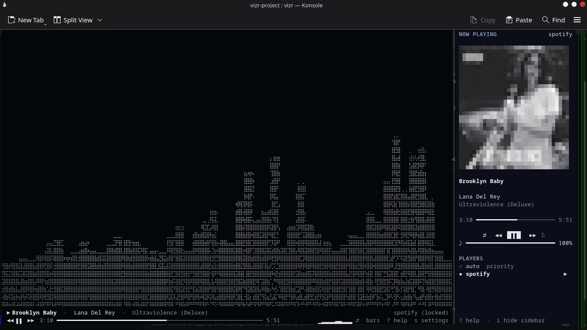
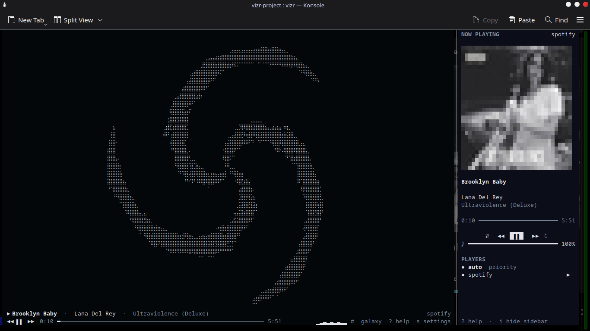
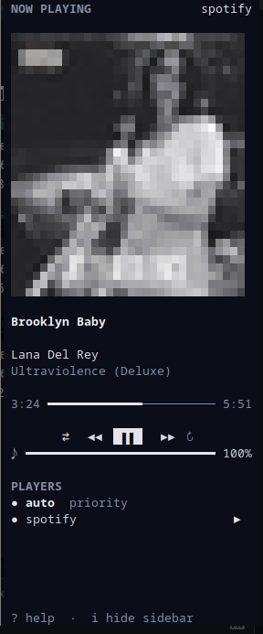

# vizr

Braille particle visualizer for the terminal. Plays nice with Spotify, any MPRIS player, or just your system audio.

```
pip install vizr
vizr
```



## what's new in 5.1.0

- **24 modes, up from 12.** New ones: tunnel, spiral, scope, warp, mandala, spectrogram, torus, rain, bloom, vortex, ribbons, comets.
- **Mode morphing.** Switching modes glides the cloud from the old shape to the new one instead of snapping. `morph` in settings controls the glide time, `0` = instant.
- **Sparkle.** Fast-moving particles randomly twinkle. On by default at `0.15`.
- **Credits tab.** Press `9` in the settings panel, or run `vizr --credits` from the shell.
- **Four new presets.** Hyperspace, Zen, Bloom, Turbine.

## what it does

Captures your audio, turns the spectrum into a few thousand particles, and draws them as braille dots — so you get 2×4 sub-pixel resolution per cell instead of the usual one-block-per-character.

Twenty-four modes, all audio-reactive:

- **spectrum**: `bars`, `mirror`, `radial`, `wave`, `scope`, `spectrogram`
- **organic**: `galaxy`, `helix`, `sphere`, `flow`, `aurora`, `terrain`, `lissajous`, `ripple`
- **geometric**: `mandala`, `torus`, `rain`, `bloom`, `ribbons`
- **motion**: `tunnel`, `spiral`, `warp`, `vortex`, `comets`



## player stuff

Polls MPRIS through `playerctl`, so whatever's playing shows up in the HUD — title, artist, album, position, and the cover art if you have Pillow installed. Play/pause, skip, seek, shuffle, loop and volume all work from the keyboard or by clicking the HUD.

It prefers Spotify over a YouTube tab in Firefox, which is the one thing I actually cared about when writing it.



## audio

Tries `parec` first (PulseAudio / PipeWire), falls back to `sounddevice`, and if neither works it plays a built-in demo loop so you can still see the visuals. `--demo` forces the demo signal, `--device` and `--monitor` pick the capture source explicitly.

## keys

Press `?` in the app for the full list. The ones you'll actually use:

| | |
|---|---|
| `1`–`9`, `0` | first ten modes |
| `m` / `M` | cycle through all 24 |
| `space` | play / pause |
| `,` `.` | previous / next track |
| `s` | settings panel |
| `i` | info sidebar |
| `q` | quit |

Settings persist to `~/.config/vizr/config.json`. Everything in the settings panel is also a config key, so you can hand-edit the JSON if that's your thing.

## requirements

- Python 3.8+
- `numpy`, `pillow`, `sounddevice` (installed automatically)
- Linux or macOS (Windows support is planned for 5.2.x)
- A terminal with truecolor and a font that has braille (most do)
- PortAudio on the system: `sudo pacman -S portaudio` on Arch, `sudo apt install libportaudio2` on Debian/Ubuntu, `brew install portaudio` on macOS
- Optional: `playerctl` for the now-playing HUD

## installation

system-wide installation
```bash
pipx install vizr
```

nix
```bash
nix run https://github.com/exotic-erox/vizr
```

## why braille

A cell is 2×4 dots, so a 120×40 terminal is really 240×160 pixels. That's enough to draw particles with trails without them looking like scattered blobs. The dots are also anti-aliased by the font itself, so motion looks smoother than it has any right to at this resolution.

## license

MIT.

## Social

[](https://pypi.org/project/vizr/)
[](https://github.com/exotic-erox/vizr)
[](https://discord.com/users/1515183303995560096)
